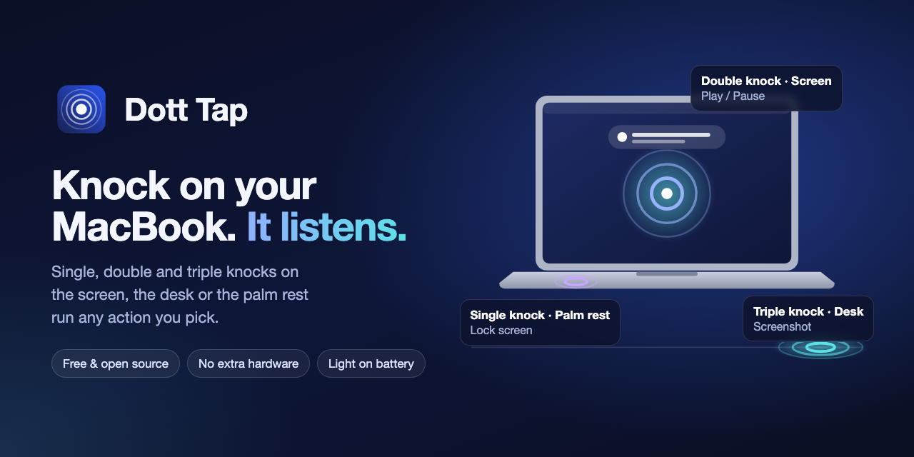
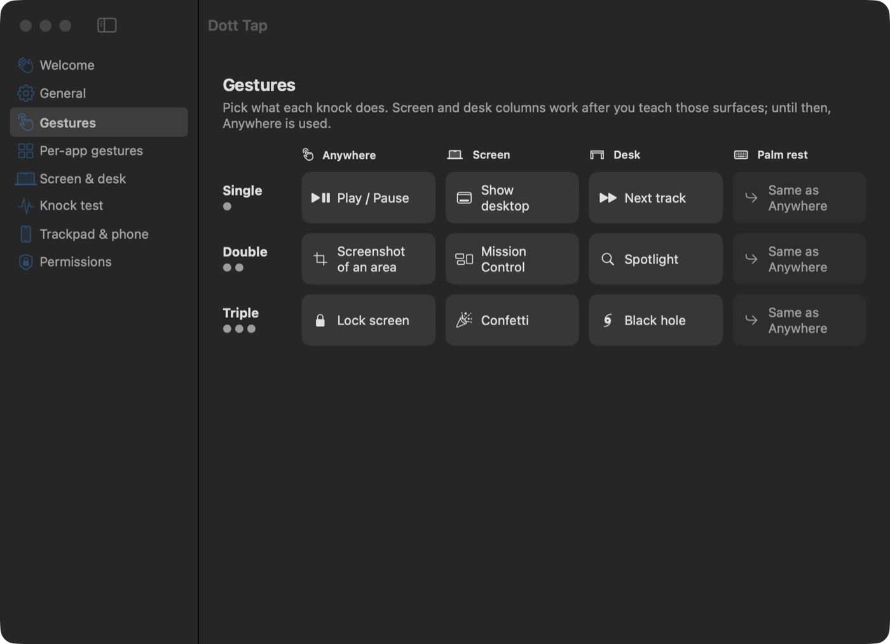
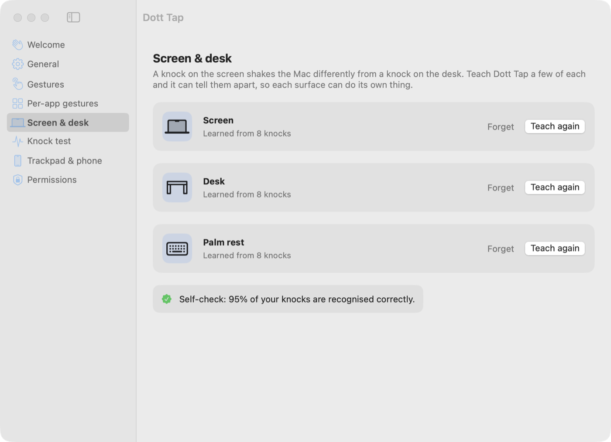
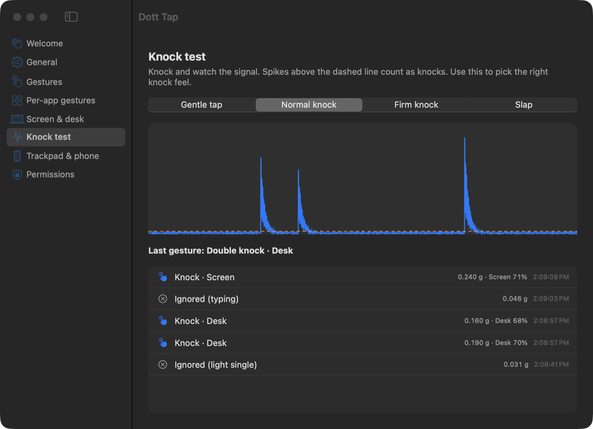
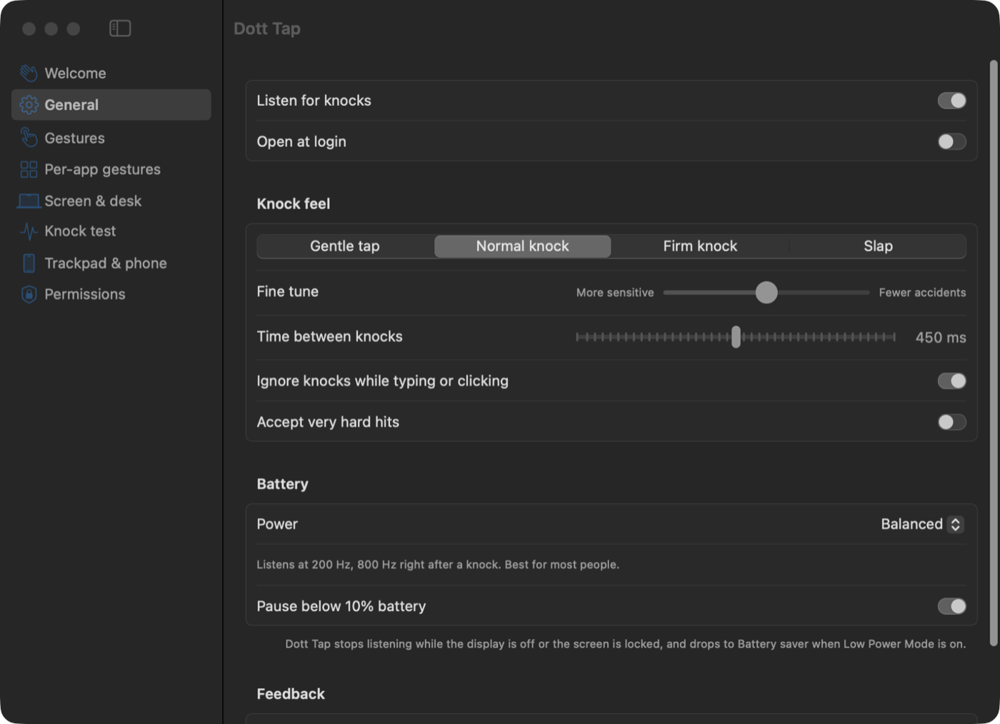
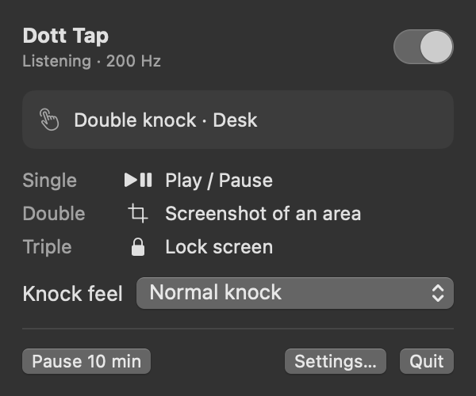

<p align="center">
  
</p>

<h1 align="center">Dott Tap</h1>

<p align="center">
  <b>Knock on your MacBook to control it.</b><br>
  Double-knock the desk to pause music. Knock the lid to take a screenshot. Triple-knock the palm rest to lock the screen.
</p>

<p align="center">
  <a href="https://github.com/mohammaddanyal/dott-tap/releases/latest"></a>
  
  
  <a href="LICENSE"></a>
  <a href="https://github.com/mohammaddanyal/dott-tap/stargazers"></a>
</p>

<p align="center">
  <a href="https://github.com/mohammaddanyal/dott-tap/releases/latest"><b>Download for Mac</b></a> ·
  <a href="https://opendott.in/products/dott-tap/">Website</a> ·
  <a href="#how-it-works">How it works</a>
</p>

---

Your MacBook has a motion sensor inside it. Dott Tap reads it, notices when you knock on
the Mac or the desk it's sitting on, and runs whatever you've picked for that knock.
No extra hardware, no admin password, and it's free.

## What it does

- **Single, double and triple knocks**, each with its own action.
- **Knows where you knocked.** Teach it 8 knocks on the screen, the desk and the palm
  rest, and each surface can do something different. On our test Mac it gets 95% right.
- **Different gestures per app.** Next slide in Keynote, mute in Zoom, skip in Spotify.
- **55+ actions**: play/pause, next track, volume, brightness, lock screen, sleep display,
  Mission Control, show desktop, switch desktops, browser tabs, copy/paste/undo,
  screenshots, any keyboard shortcut, type text, open an app or website, run an Apple
  Shortcut, a shell command or an AppleScript.
- **Reactions for fun**: screen flash, shockwave, glitch, your own text, confetti,
  a bouncing ball, a combo counter that ends in KNOCKOUT!, a gravity stack and a black hole.
- **Trackpad Tap Mode**: hold a key and click the trackpad. Works on any Mac.
- **Phone remote**: scan a QR code and your phone becomes a knock pad on the same Wi-Fi.
- **Knock test**: a live graph of the sensor, with every knock it took and every one it ignored.
- **Ignores the noise**: typing, clicking, adjusting the lid and picking the Mac up don't count.

## Screenshots

<p align="center">
  
  
</p>
<p align="center">
  
  
</p>
<p align="center">
  
</p>

## Install

1. Download `DottTap-x.y.z.dmg` from [Releases](https://github.com/mohammaddanyal/dott-tap/releases/latest)
   and drag **Dott Tap** into Applications.
2. Open it. macOS will say it can't check the app for malware, because Dott Tap isn't
   notarised by Apple (that needs a paid developer account). Go to
   **System Settings → Privacy & Security**, scroll down and click **Open Anyway**.
   Or run this once in Terminal:
   ```bash
   xattr -dr com.apple.quarantine "/Applications/Dott Tap.app"
   ```
3. Allow **Accessibility** when it asks. That's what lets it press keys for you.
4. Knock twice near the trackpad, firmly, like knocking on a door.

Want screen and desk to do different things? Open **Settings → Screen & desk** and teach it.

### Which Macs

| | Knock detection | Trackpad & phone modes |
| --- | --- | --- |
| MacBook Air / Pro with M2, M3, M4 or newer | ✅ | ✅ |
| MacBook with M1 | Not sure yet, [tell us](https://github.com/mohammaddanyal/dott-tap/issues/new?template=mac_report.md) | ✅ |
| iMac, Mac mini, Mac Studio | No motion sensor | ✅ |

Needs macOS 14 Sonoma or later. Tested on a MacBook Air M3 with macOS 27.

## How it works

Apple Silicon MacBooks have an accelerometer wired to the Sensor Processing Unit (SPU).
macOS doesn't offer a public API for it, but it shows up as an ordinary HID device:
`AppleSPUHIDDevice`, vendor usage page `0xFF00`, usage `3`. Each 22-byte report carries
x, y and z as little-endian `Int32` at offsets 6, 10 and 14, in units of 1/65536 g. Any
user can open it, so Dott Tap needs no root helper.

```
SPU accelerometer ──► high-pass filter ──► knock detector ──► surface classifier ──► gesture ──► action
   100–800 Hz          drops gravity &       adaptive noise      screen / desk /       1, 2 or 3
                       slow movement         floor, echo guard   palm rest             knocks
```

- **Detecting a knock.** A 13 Hz high-pass filter removes gravity and slow motion. A knock
  has to rise well above the background noise, which the app keeps measuring, and then
  die down within about 0.2 seconds. Anything that keeps ringing, or tilts the Mac, is
  someone moving it, not knocking.
- **Not counting echoes.** A knock rings for 30 to 150 ms. Dott Tap waits for the ring to
  fade, then raises the bar for the next knock and lowers it again over the next few
  hundred milliseconds, so a ring-out is never read as a second knock.
- **Telling surfaces apart.** Each surface shakes the Mac in its own direction. On our
  test Mac, a screen knock moves it sideways, a desk knock comes up through the rubber
  feet, and a palm rest knock pushes down. The app learns from 8 of your knocks per
  surface and matches new ones against them (nearest neighbours on axis share, first-jolt
  direction, ring time and low-frequency wobble).
- **Ignoring typing.** Typing makes jolts of 0.03 to 0.09 g, as big as a gentle knock.
  Knocks within 0.3 seconds of a key press or click are dropped, and a lone single knock
  has to be clearly firmer than the minimum.

### Battery

- It listens at **200 samples a second** and switches to **800** for two seconds after
  something moves. The switch takes about 1 ms, so the knock itself is still captured in full.
- The signal processing runs on its own low-priority thread with no memory allocations
  per sample. The main thread only wakes up when a real knock is found.
- On an M3 MacBook Air that comes to about **0.7% of one CPU core** while listening.
- It stops listening completely when the display is off, the screen is locked or the Mac
  sleeps, and below 10% battery. Low Power Mode drops it to 100 samples a second.

## Privacy

Everything stays on your Mac. Dott Tap only reads motion. It has no microphone or camera
access and doesn't send anything anywhere. To help tune sensitivity it keeps a small log of
knock measurements (numbers only, under 1 MB) in
`~/Library/Application Support/Dott Tap/events.jsonl`.

## Build from source

You only need the Xcode command-line tools.

```bash
git clone https://github.com/mohammaddanyal/dott-tap.git
cd dott-tap
./scripts/setup-signing.sh   # once: local certificate so Accessibility survives rebuilds
./scripts/build-app.sh       # writes dist/Dott Tap.app and a DMG
```

## FAQ

**Will knocking hurt my MacBook?**
No more than tapping the desk next to it. Knock like you'd knock on a door, not a slap.
The default "Normal knock" is tuned for that.

**It triggers when I don't want it to.**
Pick "Firm knock" in Settings, or use double and triple knocks for actions that matter.
A single knock is the easiest to make by accident.

**It misses my knocks.**
Open **Knock test** and watch the graph while you knock. If your knocks don't reach the
dashed line, choose "Gentle tap" or move the fine-tune slider left.

**Why isn't it on the App Store?**
Reading the motion sensor uses a private hardware interface, which the App Store doesn't allow.

## Contributing

Bug reports, Mac compatibility reports and pull requests are welcome. See
[CONTRIBUTING.md](CONTRIBUTING.md).

If Dott Tap made you smile, a ⭐ helps other people find it.

## License

[MIT](LICENSE). Made by [OpenDott](https://opendott.in) in Tamil Nadu, India.
